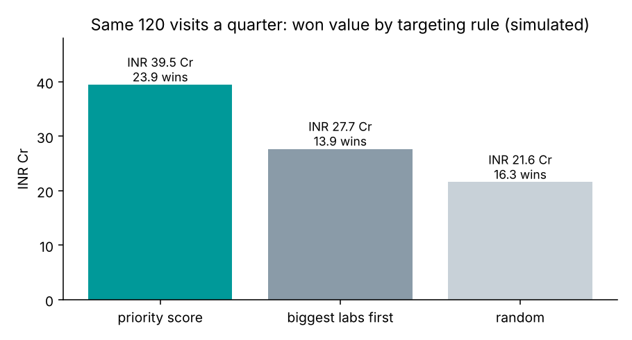

# Siemens Healthineers: Atellica CI Territory Sales Case

Built for **Siemens Healthineers' PS-II sales and marketing internship (Gurugram / Bengaluru)**: which labs and
hospitals should a rep call first, what to pitch each one, and when.

**Data:** 600 **simulated** hospital and lab accounts across **Delhi NCR and Bengaluru** (type, daily test
volume, immunoassay share, current analyser vendor and age, relationship, budget month). It is not Siemens
Healthineers or customer data. Commercial assumptions are listed below so anyone can change them.

## What it does
1. **Opportunity value per account:** annual reagent revenue if won + analyser price.
2. **Fit score a rep can explain:** analyser age, immunoassay-heavy menu, existing relationship, current vendor.
3. **Priority tiers (A/B/C)** and a **budget calendar** for timing demos.
4. **Strategy test:** 300 simulated quarters comparing three ways to spend the same 120 account visits.
5. **Sales playbook** (`docs/sales_playbook.md`): who to call, pitch by segment, proof points, timing.

## Results (simulated)
| Question | Result |
| --- | --- |
| Market in the two territories | 600 accounts, about **INR 774 Cr** of first-year opportunity value; hospitals in Delhi NCR are the largest segment (INR 211 Cr) |
| Where switching is most likely | Accounts on local/refurbished analysers and existing Siemens accounts have the highest fit; 276 accounts have analysers 7+ years old |
| Tier A | 90 accounts (15%) |
| Best way to spend 120 visits a quarter | **Priority score: 23.9 wins, INR 39.5 Cr** vs biggest labs first 13.9 wins, INR 27.7 Cr vs random 16.3 wins, INR 21.6 Cr |
| When to demo | Tier A budgets cluster in Nov–Mar |

The fit score uses the same drivers the simulation assumes, so the strategy test shows how to compare targeting
rules, not proof that these drivers hold in the market. On real CRM data, the score would be fitted to past wins.

## Assumptions
| Assumption | Value |
| --- | --- |
| Reagent revenue per test | INR 55 |
| Working days per year | 330 |
| Analyser price | INR 60 lakh |
| Share of a won account's tests moved to the new analyser | 60% |
| Rep capacity | 120 account visits per quarter (60 per territory) |

## Run
`pip install -r requirements.txt && python run.py && pytest -q`
